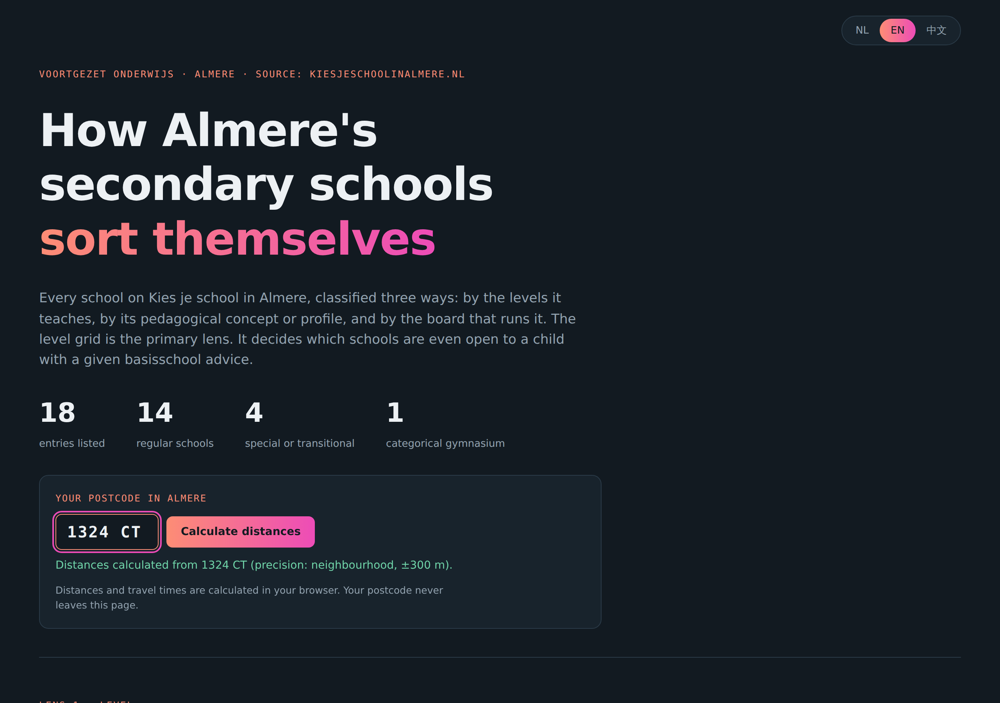
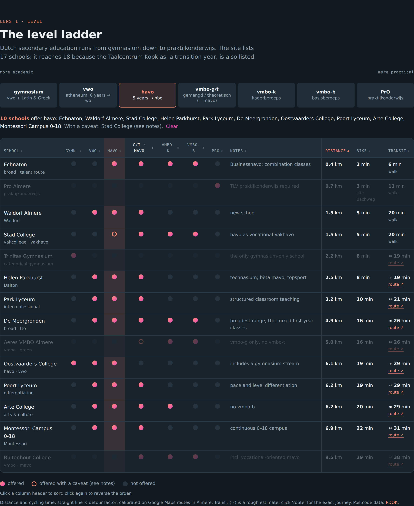
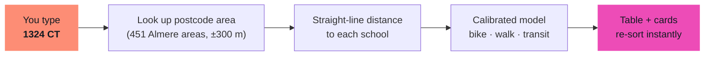

<div align="center">

# 🏫 Almere VO Schools Map

### Find the right secondary school in Almere in under a minute.

**Every school by level, by teaching style and by distance from your front door.**
**In Dutch, English and 中文.**

[](https://panjieke.github.io/almere-scholen/)




</div>

---

## 🤔 The problem

Every year, thousands of Almere families with a child in **groep 7 or 8** face the same puzzle.

- There are **18 options**, from *praktijkonderwijs* to *gymnasium*.
- There are **six levels**, plus Dalton, Montessori, Waldorf, bilingual (tto) and vocational profiles.
- The questions that actually decide it are practical: *which schools can my child go to with this advice, and how long is the trip every morning?*

The official information is complete but spread out. You read it school by school, page by page, with no way to compare side by side, and with nothing in English or Chinese for the city's many international families.

## ✨ The answer

One page. Type your postcode, click a level, and the city reorganises itself around your child.

<div align="center">

<br><sub>Click <b>havo</b> on the level ladder → 10 schools light up, sorted by distance from your postcode.</sub>
</div>

## 🚀 What you can do

| | Feature | Why it matters |
|---|---|---|
| 🪜 | **Clickable level ladder** from gymnasium down to PrO | See instantly which schools accept your child's *schooladvies* |
| 📍 | **Your postcode → live distances** | Distance, cycling time and public-transport estimate for every school, calculated on the spot |
| ↕️ | **Sort any column** | Nearest first, shortest bike ride, or all vwo schools at the top |
| 🧭 | **Three lenses**: level · concept · school board | Dalton vs Montessori vs Waldorf vs tto, explained in plain words |
| 🗂️ | **Full school directory** | Motto, levels, highlights, address, phone and website, with filters and search |
| 🌍 | **Trilingual**: Nederlands · English · 中文 | One link for every parent at the school gate |
| 🌙 | **Dark by default, phone-friendly** | Built to be read on the sofa, on a phone, at 22:00 |
| 🔒 | **Privacy by design** | Your postcode never leaves your browser. No cookies, no analytics, no server |

<div align="center">

<br><sub>The directory on a phone, in Chinese, sorted by distance.</sub>
</div>

## 🧮 How the "on-the-fly" distance works

No API keys, no backend, and nothing about you is sent anywhere. The whole map of Almere ships inside the page.



- **Postcode → location:** neighbourhood-level centroids for all 5,990 Almere postcodes, from the Dutch national address register ([PDOK](https://www.pdok.nl/) / Kadaster), compressed into 4 KB.
- **School locations:** each address geocoded through PDOK.
- **Travel model:** calibrated against 15 real Google Maps routes across Almere.
  - 🚲 Bike ≈ `1 + 3.9 × km`, usually within 1–2 minutes of Google.
  - 🚶 Walk ≈ `2 + 15.5 × km`.
  - 🚌 Transit ≈ `13 + 3.4 × km`. This is a deliberate rough estimate (shown with **≈**), and every row has a **route ↗** link for the exact journey.

> **Honest by design:** estimates are marked as estimates. If walking is about as fast as the bus, the page tells you to walk.

## 📚 What's inside

| Lens | Covers |
|---|---|
| **Level** | gymnasium · vwo · havo · vmbo-g/t (mavo) · vmbo-k · vmbo-b · praktijkonderwijs |
| **Clusters** | Six groups, from *categorical gymnasium* to *broad scholengemeenschap* |
| **Special & transitional** | Aventurijn · Nautilus College · OPDC Almere · Taalcentrum Kopklas |
| **Concept** | Dalton · Montessori · Waldorf · tto · arts · vocational · structured · differentiation |
| **Board** | ASG (openbaar) · Het Baken · Aeres · Eduvier · Almere Speciaal |

## 🛠️ Run it yourself

It is **one HTML file**. That's the whole stack.

```bash
git clone https://github.com/panjieke/almere-scholen.git
cd almere-scholen
open index.html        # macOS. Or just double-click it.
```

**Deploy your own copy:** fork the repo, then go to **Settings → Pages → Deploy from branch → `main` / root**. You'll have a live site in about 60 seconds.

```
almere-scholen/
├── index.html      ← the entire app (HTML + CSS + JS + postcode data)
├── README.md
└── docs/           ← screenshots for this README
```

## 🙌 Help keep it accurate

Schools change their programmes, open days and addresses. If you spot something out of date:

1. Open an **[issue](https://github.com/panjieke/almere-scholen/issues)** with the school name and a link to the source.
2. Or send a pull request. All school data lives in the `S` array inside `index.html`, with one block per school in all three languages.

Translations improved by native speakers are especially welcome. 🇳🇱 🇬🇧 🇨🇳

## 🗺️ Roadmap ideas

- [ ] Open days calendar with "add to my agenda"
- [ ] Compare two or three schools side by side
- [ ] Exact public-transport times per postcode
- [ ] More languages (Turkish, Arabic, Polish, Ukrainian)

## ⚖️ Disclaimer

This is an **independent, personal project**. It is **not affiliated with** the schools, their boards, the Municipality of Almere or [Kies je school in Almere](https://www.kiesjeschoolinalmere.nl/).

- The information is based on public sources read on **1 October 2026** and is **subject to change** without notice.
- Travel times are estimates.
- Always verify admission rules, levels and open days **with the school itself**.
- The author accepts **no liability** for decisions made using this site.

The full terms are at the bottom of the live page.

## 🙏 Credits

- **School information:** [kiesjeschoolinalmere.nl](https://www.kiesjeschoolinalmere.nl/vo-scholen-almere) and the schools' own websites
- **Postcode and address data:** [PDOK Locatieserver](https://www.pdok.nl/) (Kadaster, open data)
- **Typography:** [Outfit](https://fonts.google.com/specimen/Outfit), [Noto Sans SC](https://fonts.google.com/noto/specimen/Noto+Sans+SC), [JetBrains Mono](https://fonts.google.com/specimen/JetBrains+Mono)

<div align="center">

---

**Made in Almere, for Almere parents. 🌷**

If this helped your family choose, give it a ⭐ so other parents can find it.

</div>
